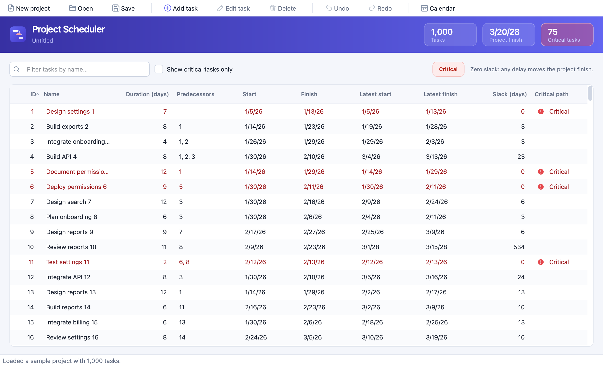

# project-scheduler

A desktop project scheduler that computes the **critical path** of a project.

You enter tasks, their durations in working days, and which tasks each one depends on. project-scheduler works out, for every task:

- the earliest and latest start and finish dates;
- the slack, meaning how far the task can slip without delaying the project;
- whether the task is on the critical path.

It also computes the project finish date. It counts only working days, using a calendar of working weekdays and holidays that you can edit.

It enforces its rules: a dependency that would create a cycle is refused, and the cycle is shown. Invalid durations and references to missing tasks are refused as well.

Every edit can be undone. Tasks can carry free-text notes, and the task table can be filtered by name or to critical tasks only. Projects are saved as JSON files.



Built with PySide6. It offers a light and a dark theme, and its interface is available in English, German and Japanese. You can switch language while the app runs.

## Requirements

- [uv](https://docs.astral.sh/uv/)
- Python 3.11 or newer (uv installs it if missing)

No network access, accounts or API keys are needed at runtime.

## Getting started

```bash
git clone <repo-url> project-scheduler
cd project-scheduler
uv sync

# Build the resources and start the app (required once after cloning,
# and after changing .qss, icons or translations):
./build_assets.sh

# Later runs, when nothing needs rebuilding:
uv run project-scheduler
uv run project-scheduler --language de --theme dark   # override the saved choices for this run
```

`build_assets.sh` (a bash script in the project folder) does four things:

1. It runs `pyside6-lupdate` to refresh `translations/*.ts` from the source.
2. It runs `pyside6-lrelease` to compile the `.ts` files to `.qm` files.
3. It runs `pyside6-rcc` to bundle the stylesheets, icons and `.qm` files into `src/project_scheduler/resources_rc.py`.
4. It starts the app. Use `--no-run` to build only. Any other options are passed to the app, for example `./build_assets.sh --language ja`.

From the project folder, run `./build_assets.sh`. The shell only finds scripts by bare name in folders on your `PATH`, so the `./` is required. It works from any directory (give its path), and with `bash`, `sh` or `zsh`.

`project-scheduler` accepts `--language en|de|ja` and `--theme light|dark`. They apply to that run only; the *View* menu changes the saved preference.


## Using it

- **Sample data:** Use *File → Load sample project* and pick a size (100, 1 000 or 5 000 tasks). This shows the app full rather than empty.
- **Editing:** Add, edit and delete tasks in the task table or the task dialog. Every edit can be undone with Ctrl+Z and redone with Ctrl+Shift+Z or Ctrl+Y.
- **Notes:** Each task can have free-text notes, entered in the task dialog. Hover over a task's name in the table to read them. Notes never affect the schedule.
- **Critical tasks only:** Tick *Show critical tasks only* next to the name filter to hide every task that has slack. It works together with the name filter.
- **Calendar:** Use *Project → Calendar…* to set the working weekdays, the holidays and the project start date.
- **Theme and language:** Both are set from the *View* menu and remembered between runs.

## Scheduling rules

- Durations are whole working days, from 0 to 9 999. A duration of 0 makes the task a milestone.
- Dependencies are finish-to-start: a task starts on the first working day after all of its predecessors finish.
- A task cannot depend on itself, on a task that does not exist, or on anything that would create a cycle.
- If the project start date is not a working day, scheduling begins on the next working day.
- Slack = latest start − earliest start, counted in working days. Tasks with zero slack are critical.

`CLAUDE.md` contains the precise day-counting convention.

### Understanding the schedule

- **You enter durations and dependencies; the app calculates everything else.** Start, Finish, Latest start, Latest finish, Slack and Critical path are all computed, so they can't be typed in and the task dialog has no fields for them.
- **A task with no predecessors starts on the project start date.** Nothing has to finish first, so it can start on day one. That's why every task shows the same Start until you add dependencies.
- **Slack comes from side-by-side chains of different lengths.** When two chains of tasks lead to the same task, the shorter chain has spare time while it waits for the longer one. Tasks on the longest chain have zero slack and are critical: any delay to them moves the project finish.

For example, in a project that starts on Monday 5 January 2026, where *Launch* depends on both *Build* and *Docs*, the task table shows:

| ID | Name | Duration (days) | Predecessors | Start | Finish | Latest start | Latest finish | Slack (days) | Critical path |
|---|---|---|---|---|---|---|---|---|---|
| 1 | Design | 3 |  | 1/5/26 | 1/7/26 | 1/5/26 | 1/7/26 | 0 | Critical |
| 2 | Build | 2 | 1 | 1/8/26 | 1/9/26 | 1/8/26 | 1/9/26 | 0 | Critical |
| 3 | Docs | 1 |  | 1/5/26 | 1/5/26 | 1/9/26 | 1/9/26 | 4 |  |
| 4 | Launch | 1 | 2, 3 | 1/12/26 | 1/12/26 | 1/12/26 | 1/12/26 | 0 | Critical |

*Launch* waits for both chains. *Design → Build* runs Monday 5 to Friday 9 January, while *Docs* takes one day, so *Docs* can start as late as Friday 9 January (its Latest start) without delaying *Launch*. That's 4 working days of slack. *Launch* starts on Monday 12 January because the weekend isn't a working day. Lengthen *Docs* to 5 days and its slack drops to 0, making it critical too. Lengthen it further and it becomes the longest chain, so *Design* and *Build* get slack instead. The Slack and Critical path columns update after every edit.

## Data files

Projects are saved as JSON (`*.schedule.json`). Each file records a `format_version`. The current version is 2, which added task notes. Files saved in version 1 are upgraded automatically when opened: the app says so once, and the tasks get empty notes.

Files are written atomically: the app writes to a temporary file and then renames it.

If a file is missing, unreadable, from a newer version, or fails validation, the app does not crash. It starts with an empty project, tells you what happened, and keeps a copy of the damaged file next to it as `<name>.corrupt-<timestamp>`.

Settings such as theme, language and recent files are stored with `QSettings`.

## Tests

```bash
./build_assets.sh --no-run             # tests import the compiled resources
uv run pytest tests/
```

- `tests/domain/` tests the scheduling rules and calculations in pure Python, without Qt.
- `tests/storage/` tests saving, loading, versioning and damaged-file recovery.
- `tests/ui/` uses `pytest-qt` to check that every window and dialog opens and responds. It also covers undo/redo, theme switching and language switching.

The UI tests run headless (`QT_QPA_PLATFORM=offscreen` is set in `tests/conftest.py`).

To run one part or a single test:

```bash
uv run pytest tests/domain -q                                   # scheduling rules only (fast, no Qt)
uv run pytest tests/ui/test_dialogs.py::test_task_dialog_filter  # a single test
```

At the time of writing all 196 tests pass: 55 domain, 26 storage and 115 UI.

## Known issues

No problems are known at the moment.

## Limitations

These are how the app is designed, not bugs:

- **A task can't be pinned to a specific date.** A task with no predecessors always starts on the project start date.
- **Long task names can be cut off.** The *Name* column gets the width the other columns leave free, so at the default window size, and more so in narrower windows, long names end in "…". Drag the column wider, or widen the window.
- **The window has a minimum width that depends on the language.** It can't be made narrower than the full toolbar, so no toolbar button is ever hidden: about 1 000 px in English, 1 080 px in Japanese and 1 270 px in German.
- **Sample projects use English task names in every language.**
- **In the date picker, weekends are shown in red in both themes** (Qt's default).
- **Opening a file saved before task notes were added** (format version 1) shows an "upgraded" message once.
- **The automated UI tests don't cover the macOS look.** They run on Qt's offscreen platform, which uses Qt's own widget style and file dialogs instead of the native macOS ones. macOS-specific appearance was checked by hand.
- **Dependency versions are not locked in the repository.** The repository's `.gitignore` excludes `uv.lock`, so `uv sync` on a fresh clone may install newer versions of PySide6 than the one this was built and tested with (PySide6 6.11.2).

## Project layout

```
src/project_scheduler/
  domain/      pure-Python model, calendar, scheduler, validation (no Qt imports)
  storage/     JSON load/save, format versions, migrations
  samples/     deterministic sample-project generator
  ui/          windows, dialogs, table models, undo commands, theming, i18n
  resources/   resources.qrc, light.qss, dark.qss, icons
translations/  project_scheduler_de.ts, project_scheduler_ja.ts
build_assets.sh  builds translations and resources, then runs the app
tests/         domain/, storage/, ui/
```